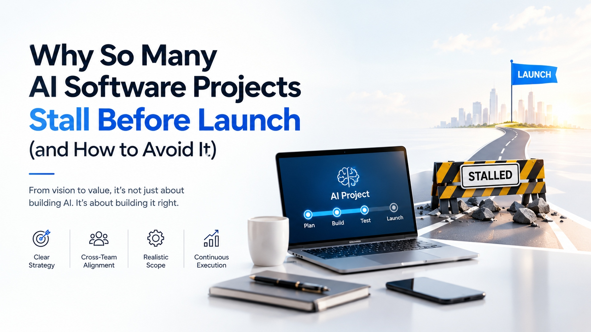

# Why So Many AI Software Projects Stall Before Launch (and How to Avoid It)

> From vision to value, it's not just about building AI. It's about building it right.

Most AI software projects do not fail because the model is weak. They stall because something upstream was never settled: the problem was vague, the data was not ready, nobody owned the outcome, or the controls arrived too late. A clear [AI implementation roadmap](https://zignuts.com/ai-services/custom-ai-development/ai-software-development-services?utm_source=seo_web2.0&utm_medium=backlink&utm_campaign=seo_referral&utm_id=10) helps teams make these decisions in the right order, before they become expensive to fix.

This guide explains the most common reasons AI projects get stuck between "Plan, Build, Test" and "Launch", and what to do about each one.

## Table of Contents

- [The Four Principles](#the-four-principles)
- [Why AI Software Projects Stall](#why-ai-software-projects-stall)
- [How to Avoid It](#how-to-avoid-it)
- [Warning Signs Your Project Is Stalling](#warning-signs-your-project-is-stalling)
- [Pre-Launch Checklist](#pre-launch-checklist)
- [The Order to Follow](#the-order-to-follow)
- [Contributing](#contributing)

## The Four Principles

| Principle | What It Means |
|---|---|
| **Clear Strategy** | The project solves a defined business problem with measurable success criteria |
| **Cross-Team Alignment** | Business, technology, data, and risk teams agree on goals and ownership |
| **Realistic Scope** | The first release is small enough to finish and prove value |
| **Continuous Execution** | Monitoring, feedback, and improvement continue after launch |

## Why AI Software Projects Stall

### 1. The problem is unclear
Teams start with a technology demo and search for a use case afterward. Without a specific problem and a baseline, nobody can tell whether the project is succeeding.

### 2. The data is not ready
A prototype works on a curated sample. Real data brings duplicates, outdated records, conflicting sources, and access restrictions that the prototype never faced.

### 3. The scope keeps growing
Every stakeholder adds a feature. The first release becomes too large to finish, and launch keeps moving.

### 4. Nobody owns the outcome
A technical team delivers the build, but no business owner is accountable for adoption or results. Decisions fall between teams.

### 5. The pilot never becomes a product
Proofs of concept succeed under close supervision, then stall when they need integrations, monitoring, security reviews, and support.

### 6. Governance arrives too late
Security, privacy, and risk reviews begin after the system is built, which forces rework or blocks launch entirely.

## How to Avoid It

| Stage | What to Do | Question to Answer |
|---|---|---|
| **Plan** | Define the problem, baseline, and success measures | What should improve, and by how much? |
| **Prepare** | Check data quality, access, and integration needs | Can the system reach reliable information? |
| **Build** | Ship a focused first version, not the full vision | What is the smallest release that proves value? |
| **Test** | Use realistic data, edge cases, and real users | How does it behave when inputs are messy? |
| **Launch** | Roll out in stages with monitoring and clear ownership | Who responds when something goes wrong? |
| **Improve** | Review results and adjust or retire what does not work | Is it still worth the cost? |

## Warning Signs Your Project Is Stalling

- The launch date has moved more than once.
- The scope grows every sprint.
- No one can state the success metric in one sentence.
- Demos look good, but production requirements keep appearing.
- Security or compliance reviews have not started.
- No business owner attends planning meetings.
- The team is debating models more than outcomes.

If three or more apply, pause and revisit the plan before adding more development effort.

## Pre-Launch Checklist

- [ ] The business problem and baseline are documented
- [ ] A named business owner is accountable for the outcome
- [ ] Data sources are identified, owned, and reliable enough
- [ ] Integrations with existing systems are tested
- [ ] Security, privacy, and access controls are reviewed
- [ ] The first release scope is agreed and frozen
- [ ] Testing included realistic data and difficult cases
- [ ] Monitoring and incident handling are in place
- [ ] Users are trained and know how to verify outputs
- [ ] Success measures will be reviewed after launch

## The Order to Follow

1. Define the business problem and its baseline.
2. Confirm that AI is the right approach.
3. Assess readiness across leadership, data, systems, and people.
4. Fix the data sources and integrations the project depends on.
5. Establish proportionate governance and ownership.
6. Build a focused first release and test it with real users.
7. Launch in stages, then monitor, review, and improve.

## Contributing

Suggestions are welcome. If you have a stall pattern or a fix that worked for your team, open an issue or submit a pull request with a short description and, where possible, a real example.
